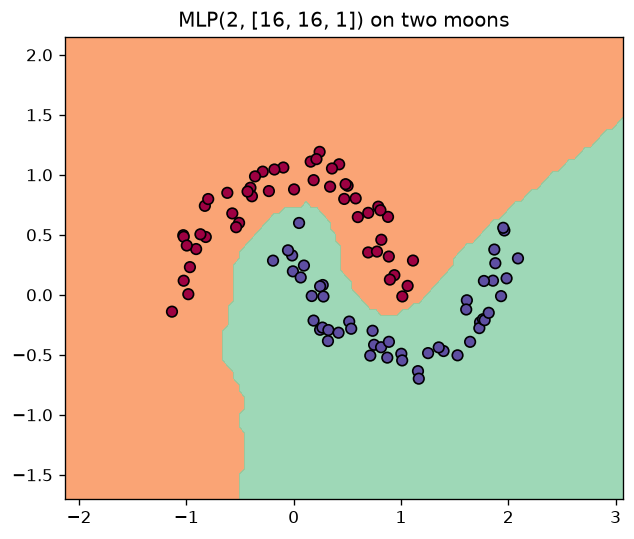
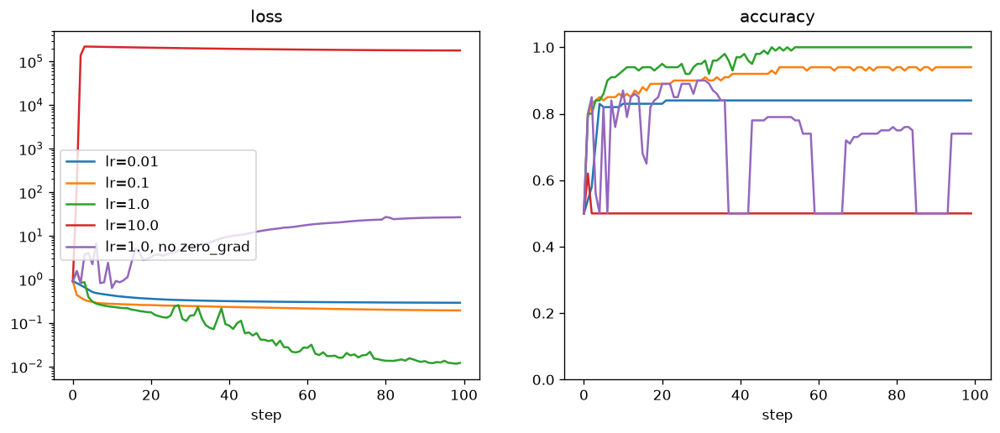

# Stage 1 notes

## Training on two moons

`MLP(2, [16, 16, 1])`, 337 parameters, 100 samples, hinge loss + L2 (α = 1e-4),
full-batch gradient descent, lr 1.0 decaying linearly to 0.1, 100 steps.

- Accuracy: 50% → 95% by step 20 → **100% by step 50**; final loss 0.012.
- One step (forward + backward over 100 samples) ≈ 0.3 s in pure Python.

## Gradient checks

`test_engine.py` (15 tests): every op vs central differences
`(f(x+h) - f(x-h)) / 2h`, two composite expressions vs PyTorch, a full MLP's
weight gradients vs the same network in PyTorch, and a 5000-node-deep graph.
All pass.

## Experiments (1.4)

Same setup, 100 steps each (`experiments.py`):

| Run | Final loss | Final accuracy |
|---|---|---|
| lr = 0.01 | 0.29 | 84% |
| lr = 0.1 | 0.19 | 94% |
| **lr = 1.0** | **0.012** | **100%** |
| lr = 10.0 | 179 266 | 50% |
| lr = 1.0, no `zero_grad()` | 26.6 | 74% |

**Too small a learning rate** (0.01, 0.1): the loss goes down smoothly but
slowly and flattens out; after 100 steps the model is still far from
separating the moons. It would get there, just in many more steps.

**Too large a learning rate** (10): the first steps overshoot, weights blow
up (max |w| ≈ 15 000) and the loss jumps to ~10⁵, mostly from the L2 term.
Half of the first-layer ReLUs end up outputting 0 for every input ("dead"),
and the network returns the same value (0.94) for all points, so accuracy
is stuck at 50%. A dead ReLU has zero gradient, so it never recovers.

**Forgetting `zero_grad()`**: `backward()` adds into `.grad`, so without
zeroing, each step uses the sum of all gradients so far. The effective step
grows every iteration and keeps pointing in old directions. The run starts
like the normal one (85% at step 2), then oscillates and the loss climbs
steadily to ~27; accuracy jumps between 50% and 90%.

## Bug found along the way

The first version of `Value` had `_backward` closures that captured `out`,
making `out → _backward → out` a reference cycle. Graphs were then freed
only by Python's cyclic GC, not right after each step: peak memory over 20
training steps was 482 MB vs 168 MB after the fix (`_backward(out)` now gets
`out` as an argument).
