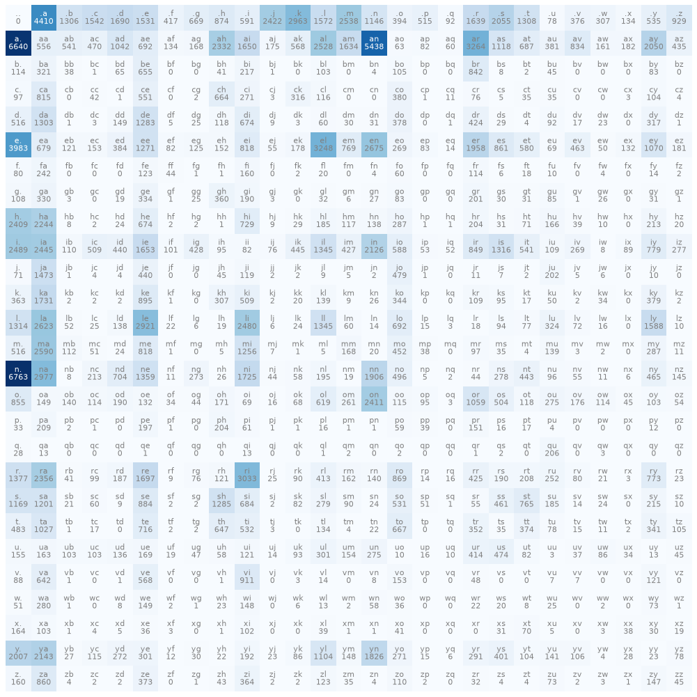

# Stage 2 notes

## Data

32 033 names, 228 146 bigrams (each name contributes `len + 1` pairs because
of the `.` start/end token), vocab of 27 = 26 letters + `.`.

Most common bigrams: `n.` (6763), `a.` (6640), `an` (5438), `.a` (4410),
`e.` (3983) — names often end in *n*, *a*, *e* and start with *a*.



## Results

| Model | NLL on names.txt |
|---|---|
| Uniform (every char 1/27) | 3.2958 |
| Counts, no smoothing | 2.4540 |
| Counts, add-one smoothing | **2.4546** |
| Neural net, 1000 steps, reg 0.001 | **2.4557** |

The neural net arrives at the same loss as counting (training loss 2.4587
includes the reg term), and its probability table differs from the count
table by at most 0.05.

Samples from the count model. With the same seed, the neural net produces
the same first 10 names — another sign the two models are the same:

```
cexze, momasurailezitynn, konimittain, llayn, ka, da, staiyaubrtthrigotai,
moliellavo, ke, teda, ka, emimmsade, enkaviyny, ftlspihinivenvorhlasu, dsor
```

Some (*llayn*, *teda*, *moliellavo*) sound like names; most don't. Knowing
only one previous character is not enough: the model can't tell that
*staiyaubrtthrigotai* is far too long, since it doesn't know where it is in
the word.

Why smoothing: without it, any pair absent from the data (e.g. `jq`) has
probability 0, so a name containing it has log-likelihood −∞. With add-one
smoothing, `andrejq` gets a finite log-likelihood of −27.87. The cost is tiny:
NLL 2.4546 vs 2.4540.

## How the neural net is the same model

Input: one-hot vector of the current char (27 numbers, a single 1). Multiplying
it by W (27×27) just picks row `W[char]` — so W *is* a lookup table, like the
count table. The row is read as **logits** = log-counts; softmax turns it into
probabilities. If W were exactly `log(P_counts)`, the network would output
the count model's probabilities (tested in `test_bigram.py`). Gradient descent
on cross-entropy finds that W on its own.

The L2 term `reg * mean(W²)` pulls W toward 0, i.e. toward equal logits and
a uniform distribution — the same effect add-one smoothing has on counts.
Stronger reg = more smoothing.

## Concepts (2.4)

### Softmax

Turns arbitrary real numbers (logits) into a probability distribution:
`softmax(z)_i = exp(z_i) / Σ_j exp(z_j)`. `exp` makes every value positive,
dividing by the sum makes them add up to 1. Order is preserved: the largest
logit gets the largest probability. A network outputs unconstrained numbers;
softmax is what lets us read them as "probability of each next character".
Adding the same constant to every logit doesn't change the result, which is
why logits are effectively log-counts up to a constant.

### Cross-entropy

For one example, the loss is `−log p(correct answer)`: 0 if the model was
certain and right, large if it gave the right answer a small probability,
infinite at probability 0. Averaged over the data, it's the same thing as the
average negative log likelihood computed for the count model.

Why minimize it: maximizing the probability of the whole dataset means
maximizing a product of many probabilities. Logs turn the product into a sum
(numerically stable, nice gradients), the minus sign turns maximizing into
minimizing, and averaging makes the number independent of dataset size.
Reference point: a model that knows nothing (uniform over 27) scores
`−log(1/27) = 3.30`; our bigram gets 2.45.

### Sampling

Generation draws the next character at random **from the predicted
distribution** (`torch.multinomial`), feeds it back in, and stops at `.`.
If we always took the most likely character (argmax), the model would be
deterministic: from `.` it would always pick `a`, and from `a` the most
likely next char is `.` (6640 vs 5438 for `n`) — every name would be "a". Sampling reproduces the variety of
the data: a character with probability 10% is chosen about 10% of the time.
