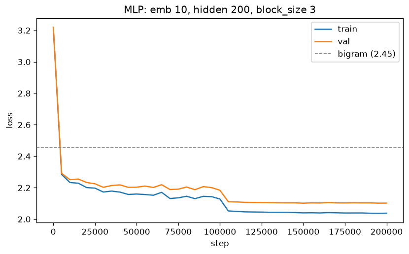
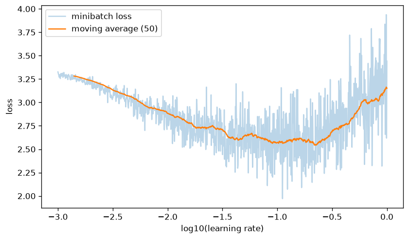
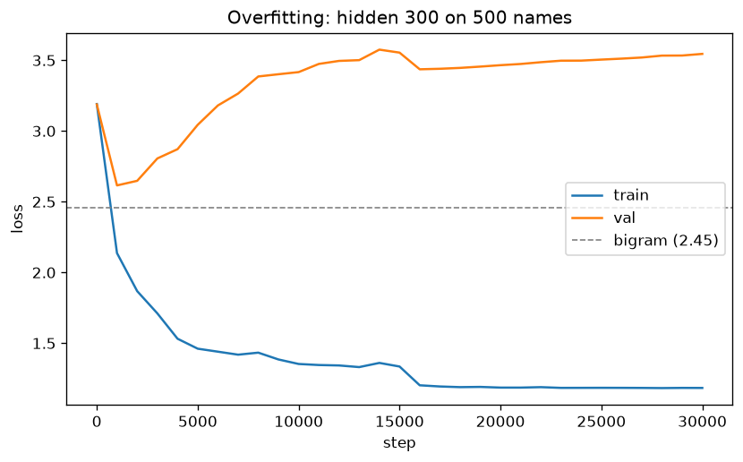
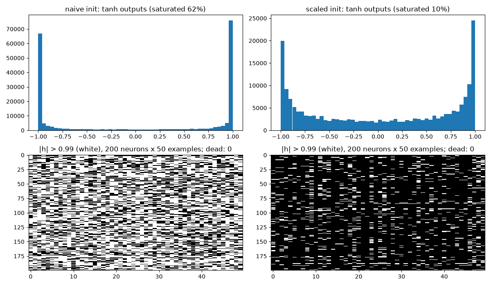
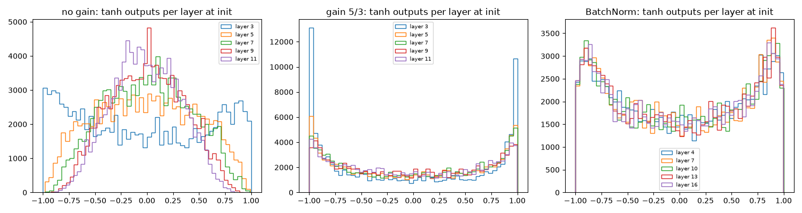
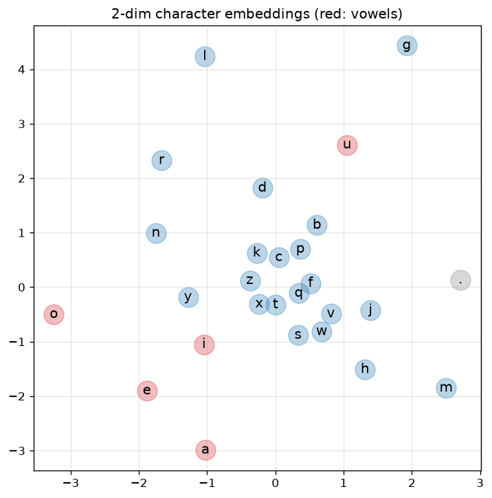

# Stage 3 notes

All numbers from runs on CPU (x86 Linux dev box). Data: `names.txt` shuffled
by name (seed 42) and split 80 / 10 / 10 → 25 626 / 3 203 / 3 204 names,
182 625 / 22 655 / 22 866 examples. `block_size = 3`.

## Results

| Model | Params | Train | Val | Test |
|---|---|---|---|---|
| Bigram (stage 2) | 729 | — | — | 2.45 (whole set) |
| **MLP**: emb 10, hidden 200 (`mlp.py`) | 11 897 | 2.038 | **2.102** | 2.103 |
| MLP + BatchNorm: emb 10, 2 × hidden 200 (`mlp_bn.py`) | 52 524 | 2.015 | **2.081** | 2.083 |
| MLP with 2-dim embeddings, 100k steps (`embed2d.py`) | — | 2.174 | 2.194 | — |

Target was val < 2.2 — met. 200k steps, batch 32, lr 0.1 → 0.01 at step 100k;
~12 min on 2 CPU cores for `mlp.py`.



The jump at step 100k is the learning-rate decay: with lr 0.1 the minibatch
noise keeps the weights bouncing around the minimum; with lr 0.01 they settle.

Samples, `mlp.py`:

```
carmahzato, hariffinrichel, cassanden, jazonna, deliah, jareen, nellara,
chaiir, kaleigh, ham, jorn, quint, sulisean, addicia, elo, dearyn, kai,
eveivelize, deciia, gian
```

Compare with the bigram's *staiyaubrtthrigotai*, *ftlspihinivenvorhlasu*.

### Why it beats the bigram

1. **Longer context.** The bigram sees 1 char, the MLP sees 3. After `.em`
   the next char is far more predictable than after just `m`.
2. **Embeddings share knowledge.** A count table for 3 chars of context
   would need 27³ ≈ 20 000 rows, most never seen in the data. The MLP
   instead maps each char to a vector, and chars that behave alike get
   similar vectors (see the 2-D plot below). What the model learned about
   `a` partly transfers to `e`, so contexts it never saw still get
   sensible predictions.
3. **The hidden layer** combines the 3 chars non-linearly, so it can learn
   things like "ends in a vowel after two consonants".

## Learning rate search



One run of 1000 steps with lr growing from 10⁻³ to 1. The smoothed loss
falls until ~10⁻¹·⁵ ≈ 0.03, stays flat up to ~10⁻⁰·⁶ ≈ 0.25 (lowest point at
0.22), and climbs after ~0.3 as the steps start to overshoot. Picked
**lr = 0.1**: in the flat region, with margin from where it blows up.

## Overfitting

`overfit.py`: hidden 300 (≈ 17k params) trained on only 500 names (3 608
examples).



Val loss is best at the very first check (2.62 at step 1000), then grows to
3.55 while train keeps falling to 1.18 — the model memorizes the 500 names
instead of learning what names look like. On the full data the gap stays
small (train 2.04, val 2.10), so the main model is not overfitting; with
~12k parameters and 183k examples it is closer to underfitting.

What to do about it: more data, a smaller model, regularization (L2,
dropout), or stopping at the best val loss.

## Stability of deep networks (3.3)

`diagnostics.py`. Expected loss at init, when the model knows nothing:
−ln(1/27) = 3.30.

### Initialization, one hidden layer

| Init | Initial loss | Logits std | tanh saturated (abs > 0.99) | Val after 30k steps |
|---|---|---|---|---|
| naive (`randn` everywhere) | **26.1** | 12.5 | 62% | 2.285 |
| scaled | **3.31** | 0.10 | 10% | 2.149 |



**Naive init** gives huge random logits, so the model is *confidently wrong*
(loss 26). The first thousands of steps are spent just shrinking the
weights. Worse, 62% of tanh outputs sit at ±1, where the gradient
`1 − tanh²` is ~0: those neurons barely learn. None was saturated for
*every* example here (no fully dead neuron in a batch of 1000), but the
damage shows: after 30k steps the naive run is still at 2.285 vs 2.149.

**Scaled init**:
- `W2 × 0.01`, `b2 = 0` → logits near 0 → uniform softmax → loss 3.31.
- `W1 × (5/3) / √fan_in` (Kaiming): a sum of `fan_in` random terms has std
  `√fan_in`, so dividing by it keeps pre-activations at std ≈ 1 regardless
  of layer width. The 5/3 gain compensates for tanh squashing its input.

### Deep net: 5 tanh layers of 100

| Config | tanh output std, layer 1 → 5 | Saturated (abs > 0.97), layer 1 → 5 | Val after 10k steps |
|---|---|---|---|
| no gain (`1/√fan_in`) | 0.62 → 0.48 → 0.41 → 0.35 → **0.32** | 3% → 0% | 2.201 |
| gain 5/3 | 0.75 → 0.69 → 0.68 → 0.66 → 0.66 | **20%** → 6% | 2.169 |
| BatchNorm | 0.63 → 0.64 → 0.64 → 0.64 → 0.63 | 3% everywhere | 2.211 |



- **No gain**: every tanh squashes, so activations shrink layer after layer
  (std 0.62 → 0.32). In a deeper net they would collapse toward 0, and so
  would the gradients.
- **Gain 5/3**: stable from layer 2 on, but layer 1 is 20% saturated.
  Getting this right by hand depends on the activation function and the
  depth, and it only holds at init — training changes the weights.
- **BatchNorm** normalizes every layer's pre-activations to mean 0, std 1
  over the batch, then lets the network rescale them with trainable γ, β.
  Every layer gets the same healthy distribution without hand-tuned gains,
  and it keeps holding during training.

In this short 10k-step run BatchNorm is not better (2.211 vs 2.169): for a
net this small, a good init already works. BatchNorm pays off as networks
get deeper. Its cost: an example's output depends on the other examples in
its batch, and eval needs separate running statistics. That's why
transformers use **LayerNorm** instead — same idea, but it normalizes over
the features of each single example, not over the batch.

The full BatchNorm model (`mlp_bn.py`) reaches val 2.081 vs 2.102 for
`mlp.py`, but it also has 2 hidden layers and 4× the parameters, so that
is not a clean comparison of BatchNorm alone.

## 2-D embeddings (3.4)



With only 2 numbers per character the model still gets val 2.19. Four of
the five vowels — **a, e, i, o** — end up together in the lower left;
**u** does not join them and sits in the upper right. `.` (start/end) is
alone on the far right: it behaves like no letter. **n, r, l, y** are on
the left half with the vowels; most other consonants crowd in the middle.
