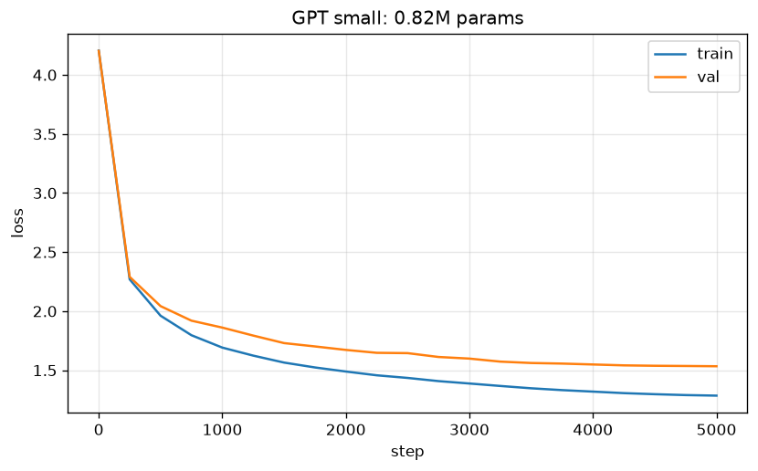

# Stage 4 notes

Tiny Shakespeare: 1 115 394 characters, 65-char vocabulary; first 90% train
(1 003 854 tokens), last 10% val (111 540). Expected loss at init:
ln(65) = 4.17.

## Results

| Model | Params | Train | Val | Time |
|---|---|---|---|---|
| Bigram (`bigram.py`, 5000 steps) | 4 225 | 2.458 | 2.477 | 16 s |
| **GPT `small`** (4 layers, 4 heads, 128, block 64) | 0.82M | 1.285 | **1.534** | 20 min, CPU |
| GPT `main` (6 layers, 6 heads, 384, block 256) | 10.79M | — | — | **not run yet: needs the Mac** |

Target for the stage: val ≈ 1.5 or lower. `small` gets close (1.534);
`main` is expected to land around 1.47 (nanoGPT's result with the same
settings) and has to be trained on the M2.

The dev box (x86, 2 cores, ~1.6 GB free RAM) can't train `main`: a smoke
test with batch 16 ran out of memory. On a Mac with 8+ GB of unified memory
it fits; time per step is unknown until it's run there.



Initial loss 4.21 (expected 4.17). Train and val separate after ~500 steps
and the gap grows to 0.25 by the end: `small` runs without dropout and
starts fitting the training text. `main` has dropout 0.2 for this reason.

## Samples

Bigram — knows which letters follow which, nothing more:

```
Kitloulf avefowind f my char n.
AStoutnqurnd fe t y e tar heed lamston,

SS:
I be thally plgnl he?
```

GPT `small`, prompt `\n`, temperature 0.8 (from `train.py`):

```
KING LEWIS XI:
No, my lord, I'll be a noble cousin,
I cannot deliver to dream a watch.
Go to, for all the citizens of his men,
And the need flesh by the fall for the presence,
That shalt married 'now some consented.
```

Speaker names in capitals with a colon, line breaks in verse-like lengths,
mostly real words, archaic forms (*shalt*, *I'll*). The meaning doesn't
hold together beyond a line — 64 characters of context is about one line.

### Temperature and top-k

`generate.py --ckpt out/small/ckpt.pt --prompt "ROMEO:" --seed 7`:

**temperature 0.5** — safe, repetitive, almost all real words:
```
ROMEO:
Good man, my lord, I have so come to myself.

DUKE VINCENTIO:
O more thanks, he shall hear you, but for your master
```

**temperature 0.8** — more varied, a few invented words:
```
ROMEO:
God and scorn more your services and more
stabb ounting than yet; and what have said they'd
```

**temperature 1.2** — falls apart: *commonour*, *drunkatemph'd*, *bE.*
```
ROMEO:
Go's not commonour, letters will sterr'd.
Rea-fankely mother, tore drunkatemph'd
```

**temperature 1.2 + top_k 10** — same high temperature, but the long tail of
unlikely characters is cut off, so the text stays readable:
```
ROMEO:
God and better of the fase; what stern makes me now?

CLEOMENES:
No, beseech, why is a charper,
```

Temperature divides the logits before softmax: below 1 the gaps between
logits grow and the distribution sharpens toward the most likely token,
above 1 it flattens and rare tokens get picked more often. Top-k removes
everything but the k best candidates, so even a flat distribution can't
pick something absurd.

## How the pieces fit (4.3–4.4)

**The trick** (`attention_trick.py`): averaging each token with all tokens
before it can be done with one matrix multiply by a lower-triangular matrix
whose rows sum to 1. Building that matrix as `softmax` of a matrix with
`-inf` above the diagonal gives the same result — and if the zeros below the
diagonal are replaced by data-dependent scores, that's attention.

**Self-attention head**: every token produces a query, a key and a value.
Score of token t for token s: `q_t · k_s / √head_size`. Scores for future
tokens are set to −inf (the mask), softmax turns each row into weights that
sum to 1, and the output is the weighted sum of values. The division by
√head_size keeps the scores at unit variance: without it, var(q·k) ≈ 20 for
head_size 16 (measured), softmax becomes nearly one-hot and each token
listens to a single other token at init.

**Why the mask**: during training the model predicts every position of the
block at once; if position t could see token t+1, it would just copy the
answer. `test_gpt.py` checks this: changing token 10 leaves the outputs at
positions 0–9 unchanged.

**Positional embeddings**: attention is a weighted sum over a set — it
doesn't know order. A learned vector per position is added to each token
embedding.

**Multi-head**: several smaller heads (here 4 × 32 or 6 × 64) look for
different relations in parallel; outputs are concatenated and projected.

**Block** = attention ("tokens talk to each other") + feed-forward ("each
token thinks on its own"), each wrapped as `x = x + f(LayerNorm(x))`:
- *residual*: the `+` gives gradients a direct path to early layers, so a
  deep stack trains as easily as a shallow one at the start;
- *pre-norm LayerNorm*: normalizes each token's features (not the batch, as
  BatchNorm did in stage 3), so every sublayer gets well-scaled input;
- *dropout*: randomly zeroes activations during training against
  overfitting.

## Training setup (4.5)

AdamW with weight decay 0.1 on matrices and embeddings only (not on biases
and LayerNorm), β₂ = 0.99, gradient clipping at 1.0. Learning rate: 100
warmup steps from ~0 to 1e-3 (Adam's statistics are unreliable in the first
steps), then cosine decay to 1e-4. Checkpoints keep model, optimizer, step,
RNG and elapsed time, so `--resume` continues exactly where training
stopped — needed on the fanless Air, which throttles under long loads.
