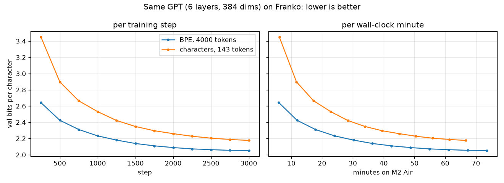

# mini-gpt

A GPT written from scratch in plain PyTorch and trained on a fanless MacBook
Air M2 with 8 GB of memory: own autograd, own BPE tokenizer, own transformer,
pretraining on a corpus I built, and a streaming web chat. No pretrained
models, no Hugging Face.

The path goes one idea at a time: micrograd → bigrams → MLP → GPT → own
tokenizer on Ivan Franko → web chat.

## Results

| Model | Data | Parameters | Training | Best val, bits/char |
|---|---|---|---|---|
| GPT, characters | Tiny Shakespeare, 1.1M chars | 10.8M | 58 min | 2.13 |
| GPT, own BPE (4000 tokens) | Ivan Franko, 7.7M chars | 13.8M | 74 min | **2.05** |
| GPT, characters | Ivan Franko, 7.7M chars | 10.9M | 67 min | 2.18 |

All three share one architecture: 6 layers, 6 heads, 384 dims, a context of
256 tokens. Bits per character compare models with different tokenizers on
the same text. Shakespeare and Franko are different texts, so compare within
a corpus.



- **The tokenizer matters.** The same model on BPE tokens beats the
  character-level one, and reaches the character model's final loss in less
  than half the time. A position holds ~3 characters instead of one, so the
  256-token context covers ~720 characters of text.
- **Ukrainian is expensive for GPT-4.** Its tokenizer packs 1.69 Ukrainian
  characters into a token against 3.70 English ones: the same amount of text
  costs 2.2× more tokens. My 4000-token BPE, trained on Franko, does 2.85
  characters per token on his prose, a little more than GPT-4o's 200k
  vocabulary (2.64). Details: [franko/NOTES.md](franko/NOTES.md).

### What it writes

Franko, BPE model, temperature 0.8:

```
— Ну, то, а ти хіба ж знаєш, що я тобі скажу? — запитав він спокійно.

— Ну, ну, ну, на мене! — сказав Шлендріян, уклонившися обома руками, благаючи
зроблющого, що я не міг доторкнутися!

— За той час! — сказав Мендель, кланяючись. — То я не догадувався, що треба.
```

Shakespeare, temperature 0.8:

```
KING LEWIS XI:
No, my lord; I'll know no longer than means.

KING EDWARD IV:
I know not what you do.
```

Real words, punctuation, dialogue layout and the author's own characters,
but no meaning beyond a sentence. These are small **base models**: they
continue text and don't answer. A chat assistant needs far more data and
parameters, then instruction tuning on top.

## Try it

```bash
python3.12 -m venv .venv && source .venv/bin/activate
pip install -r requirements.txt
python web/weights.py download   # ~170 MB: the three trained models from the latest release
python web/server.py             # http://localhost:8000
```

Or in Docker, two containers (nginx + the API on CPU):

```bash
python web/weights.py download
docker compose up --build        # http://localhost:8080
```

Generate from the command line:

```bash
python franko/generate.py --data bpe4000 --prompt "— Добрий вечір, куме!" --chars 500
python gpt/generate.py --prompt "ROMEO:" --max_tokens 500
```

## Structure

| Step | Folder | What's inside |
|---|---|---|
| 0 | [`setup`](setup) | Environment check and CPU vs MPS benchmark |
| 1 | [`micrograd`](micrograd) | Own autograd engine and a small neural net on top of it |
| 2 | [`bigram`](bigram) | Character-level bigram model: counts, then the same as a neural net |
| 3 | [`mlp`](mlp) | MLP language model with embeddings (Bengio 2003), BatchNorm, training diagnostics |
| 4 | [`gpt`](gpt) | Decoder-only transformer on Tiny Shakespeare: attention, checkpoints, early stopping |
| 5 | [`franko`](franko) | Ivan Franko corpus, own byte-level BPE, GPT trained on BPE vs characters |
| 6 | [`web`](web) | Web chat: FastAPI with streamed tokens (SSE), UI, Docker Compose |

Each stage folder has a README (what each file does, how to run it) and
NOTES with the results and what went wrong along the way. Every stage has
tests: run `python -m pytest` inside a folder.

## Train it yourself

```bash
python setup/check_env.py                    # MPS available: True

python gpt/train.py --config main            # Shakespeare, ~1 h

python franko/download.py                    # Franko corpus, ~1 h at 1 request/s
python franko/extract.py
python franko/bpe.py --vocab_size 4000
python franko/prepare.py --tokenizer bpe4000
python franko/train.py --data bpe4000        # ~75 min
```

Checkpoints go to `<folder>/out/<run>/`: `best.pt` with the lowest val loss,
`ckpt.pt` to resume with `--resume`.

## Notes on the hardware

- Device: `"mps" if torch.backends.mps.is_available() else "cpu"`. If an
  operation isn't supported on MPS, `export PYTORCH_ENABLE_MPS_FALLBACK=1`.
- The Air has no fan and throttles after 15–20 minutes of sustained load,
  so long runs save checkpoints and can be resumed.
- 8 GB is tight: with a 4000-token output a batch of 64 swaps, so the Franko
  runs use two micro-batches of 32 with gradient accumulation.
- Docker on macOS has no access to the Apple GPU, so the chat container runs
  on CPU. For generating one token at a time with a 10M model that's fast
  enough.
