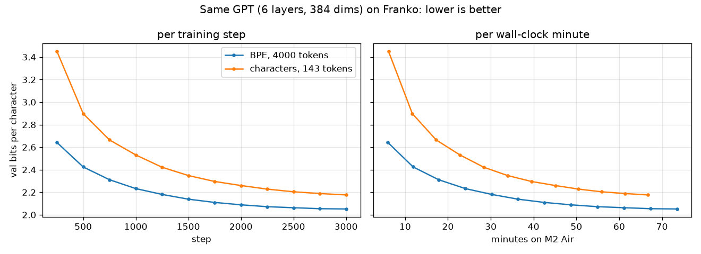

# Stage 5 notes

## 5.1 Corpus: Ivan Franko

```bash
python franko/download.py   # ~1 h: 379 works, 1073 pages, 1 request/s, cached in data/raw/
python franko/extract.py    # -> data/franko.txt
```

Source: ukrlib.com.ua, which has Franko's works in modern spelling. Franko died
in 1916, so the texts are in the public domain. The corpus itself is not
committed (`data/` is git-ignored); the scripts rebuild it.

**Result: 289 works, 7 701 328 characters (13.8 MB UTF-8), 143 distinct
characters** — 7× Tiny Shakespeare.

What cleaning had to deal with:

| Problem | Example | Fix |
|---|---|---|
| Verse has no `<p>`: bare lines with `<br>` | 234 works (all poetry, *Мойсей*) came out empty at first | take all text of the article, skip every `<div>` (ads, audiobook links, "read also") |
| Latin look-alikes in Cyrillic words | `вiн`, `тiльки`, lone `i` for *і* | swap Latin → Cyrillic in mostly-Cyrillic words; lone `i` in Cyrillic paragraphs |
| Editor's footnotes inline | `* (* Звідини — розвідка.)` | regex, one level of nested `()` |
| Editor's notes on the source edition | *Повість друкується за виданням творів…* | drop such paragraphs |
| Collections repeat poems listed on their own | *Semper tiro* and *Semper tiro (збірка)* | drop repeated paragraphs > 40 chars (208K chars, 2.6%) |
| Old Galician spelling in 2 works | *дїло, приняв ся, по роцї* | drop works with "ї" after consonants (0.7%) |
| Typography | `"…"`, `–`, `...`, `’ ʼ`, stress marks | `«…»`, `—`, `…`, `'`, removed |

Paragraphs and stanzas are separated by a blank line, works by two — the same
layout as Tiny Shakespeare, so the model can learn where a speech or stanza
ends.

## 5.2 BPE tokenizer

```bash
python franko/bpe.py --vocab_size 4000   # 41 s -> data/bpe4000.json
python franko/compare_tokenizers.py
```

Byte-level BPE from scratch (`bpe.py`): start from the 256 byte values,
repeatedly merge the most frequent adjacent pair. Text is first split into
chunks (a word with its leading space, a number, punctuation, whitespace), so
merges never cross word boundaries.

Naive training recounts all pairs after every merge. Here identical chunks
are counted once with their frequency, and after a merge only the chunks
containing that pair are updated — 3744 merges over 7.7M characters take
41 s in pure Python. A test checks that this gives exactly the same merges
as the naive version (ties are broken by the smallest ids, so the result
is deterministic).

What it learned: first common letter pairs, then endings and short words
(`ані`, `увався`), then whole frequent words. The longest tokens are whole
words with their leading space: `' розуміється'`, `' канцелярії'`,
`' робітників'`, and names from the novels — `' Борислава'`, `' Стальський'`,
`' Панталаха'`.

**2 637 017 tokens for the corpus: 2.92 characters per token.**

### Why Cyrillic is "expensive" for GPT-4

The same sentence (113 characters, 204 bytes in UTF-8):

```
ours (4000)   46 tokens: С|ум|но| і| неп|рив|іт|но| тепер| в| нашій| Т|ухоль|щ|ині|!| Правда|,| …
GPT-4 (100k)  74 tokens: С|ум|но| і| н|еп|р|ив|і|т|но| т|еп|ер| в| на|ш|і|й| Т|у|х|оль|щ|ин|і|!| П|рав|да|,| …
GPT-4o (200k) 46 tokens: С|ум|но| і| непр|ив|іт|но| теп|ер| в| наш|ій| Т|ух|оль|щ|ині|!| Правда|,| …
```

Characters per token on 1M characters (more is cheaper):

| | Franko (uk) | Shakespeare (en) |
|---|---|---|
| ours, 4k vocab | **2.85** | 1.19 |
| GPT-4, 100k | 1.69 | **3.70** |
| GPT-4o, 200k | 2.64 | 3.75 |

- Every Cyrillic letter is 2 bytes in UTF-8, so a byte-level tokenizer
  starts at 2× the cost of English before any merges.
- BPE spends its vocabulary on what is frequent in *its* training data.
  GPT-4's was mostly English: 100k tokens, yet few Ukrainian merges, so
  Ukrainian costs 1.69 chars/token against 3.70 for English — **2.2× more
  tokens for the same amount of text**, i.e. 2.2× the price and half the
  effective context. Even `її` is 4 tokens: each `ї` is split into its two
  bytes.
- GPT-4o doubled the vocabulary with more multilingual data and gets close
  to our tokenizer on Ukrainian.
- Our 4k tokenizer beats both on Franko, because all 3744 merges went to
  Ukrainian, but it's useless for English (1.19: barely better than bytes).
  The Franko number is slightly flattering — the tokenizer was trained on
  this text — but the gap to GPT-4 is far bigger than that effect.

## 5.3 Training: BPE vs characters

```bash
python franko/prepare.py --tokenizer bpe4000   # -> data/bpe4000/{train,val}.bin, meta.json
python franko/prepare.py --tokenizer char
python franko/train.py --data bpe4000          # ~75 min on the M2 Air
python franko/train.py --data char             # ~67 min
python franko/compare_runs.py                  # -> bpc_compare.png
python franko/generate.py --data bpe4000 --seed 1 --chars 500
```

The stage 4 model, unchanged: 6 layers, 6 heads, 384 dims, context 256
tokens, dropout 0.2, AdamW with cosine lr 1e-3 → 1e-4, 3000 steps of 64
sequences. Only the vocabulary differs, so only the token embedding and the
output layer change size.

**Validation split.** The corpus is ordered by work, so the last 10% would
be a few works of one kind. Instead it is cut into 100 pieces at paragraph
boundaries and every 10th piece goes to val (770K characters). Both runs use
exactly the same train and val text.

**Comparing across tokenizers.** Loss per token can't be compared: a BPE
token is ~2.8 characters, so predicting it is harder. Both runs report val
loss in **bits per character** of the same text: loss × tokens / characters
/ ln 2.

**Memory.** With a 4000-token output, a batch of 64 pushed the 8 GB Air into
swap and training stalled. Each step is now two micro-batches of 32 whose
gradients add up (gradient accumulation): the same update, half the peak
memory.

| | BPE, 4000 tokens | characters, 143 tokens |
|---|---|---|
| parameters | 13.81M | 10.85M |
| context of 256 tokens ≈ | 720 characters | 256 characters |
| speed | 1.32 s/step | 1.19 s/step |
| time, 3000 steps | 73.5 min | 66.7 min |
| **best val, bits/char** | **2.052** | 2.176 |
| train − val gap, bits/char | 0.37 | 0.17 |



- **BPE wins by 0.12 bits/char**, and it gets there sooner: after 30 minutes
  it is where the character model ends after 67.
- The reason is context. Same 256 positions, but a BPE position is a whole
  word or a large piece of one, so the model sees ~3× more text and spends
  its attention on relations between words instead of spelling them out.
- The cost: the vocabulary adds 3M parameters, and the gap between train and
  val is twice as big. A rare word gets its own token and is seen only a few
  times, so it is easier to memorize. Val was still falling at step 3000 for
  both, so `best.pt` is the last step in each run.

Loss curves of each run: [BPE](loss_bpe4000.png), [characters](loss_char.png).

### Samples

500 characters from a blank line, temperature 0.8, seed 1.

BPE:

```
— Ну, то, а ти хіба ж знаєш, що я тобі скажу? — запитав він спокійно.

— Ні, не здурілиш. Хотіли мене до матері, він обняв її і дав мені за все своє промовище.

— Ну, ну, ну, на мене! — сказав Шлендріян, уклонившися обома руками, благаючи зроблющого, що я не міг доторкнутися!

— Біда, нечистися! — сказав Лімбах. — Прийду до суду. Я на те не буду нічого від них.

— За той час! — сказав Мендель, кланяючись. — То я не догадувався, що треба.
```

Characters:

```
Замовк.

— Пане, — говорив далі і випивши свої ями, але напівперед до рук.

— Слухайте мені.

— Так, так, які не знати такого. Знайшов при лихорім оповіданні. Мій господар висилував шибний коротко до ради, правдивий староста, що значив се значити якогось багато і своїх пропадок мене до догори не було замуж до неї, вони вміли сказати, що сей находить і бачу, сирота вислали до собою від нього припустили його, коли поки ту ледве мусили відповісти в відпрошеннім скарбі.
```

Neither is coherent beyond a sentence, but the difference shows. The BPE
model writes almost only real words, keeps dialogue short and attributes it
to Franko's own characters (Шлендріян, Мендель, Лімбах). The character
model invents words (`лихорім`, `висилував`, `напівперед`) and runs a
sentence on for a paragraph: inside 256 characters it can't see where the
sentence started.
